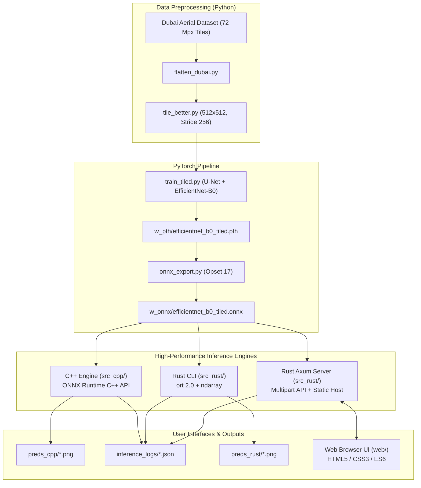

# Dubai Aerial Imagery Semantic Segmentation Engine & Server

[](https://www.rust-lang.org/)
[](https://en.wikipedia.org/wiki/C%2B%2B17)
[](https://www.python.org/)
[](https://pytorch.org/)
[](https://onnxruntime.ai/)
[](https://github.com/tokio-rs/axum)

An end-to-end semantic segmentation pipeline and production-grade inference server designed for high-resolution aerial and satellite imagery of Dubai, UAE.

The system features:
1. **PyTorch Training Pipeline** (`src_py/`): Full training workflow with patch tiling, augmentations, and U-Net (EfficientNet-B0 backbone).
2. **ONNX Export & Optimization** (`src_py/onnx_export.py`): Production export with dynamic batch dimensions.
3. **C++ Native Inference CLI** (`src_cpp/`): Low-latency sliding-window inference using Microsoft ONNX Runtime C++ API.
4. **Rust Native Inference CLI** (`src_rust/`): High-concurrency sliding-window inference with `ort` and zero-copy memory management.
5. **Interactive Web Application** (`src_rust/` + `web/`): Async Axum REST server with modern glassmorphism web UI for drag-and-drop segmentation, real-time overlay blending, class distribution analytics, and PNG export.
6. **Unified Structured Logging** (`inference_logs/`): Consolidated JSON session logs recording per-image latencies, tile counts, and batch statistics across all engines.

---

## Table of Contents

- [Dubai Aerial Imagery Semantic Segmentation Engine \& Server](#dubai-aerial-imagery-semantic-segmentation-engine--server)
  - [Table of Contents](#table-of-contents)
  - [System Architecture](#system-architecture)
  - [Dataset \& Semantic Classes](#dataset--semantic-classes)
    - [Dataset Reference](#dataset-reference)
    - [Class Palette](#class-palette)
  - [Repository Structure](#repository-structure)
  - [1. Model Training (PyTorch)](#1-model-training-pytorch)
    - [Environment Setup](#environment-setup)
    - [Dataset Preparation \& Tiling](#dataset-preparation--tiling)
    - [Running Model Training](#running-model-training)
    - [Pure PyTorch Inference](#pure-pytorch-inference)
  - [2. ONNX Model Export](#2-onnx-model-export)
    - [Exporting Checkpoint](#exporting-checkpoint)
    - [Model Tensor Signatures](#model-tensor-signatures)
    - [Quantization Notes](#quantization-notes)
  - [3. High-Performance C++ Inference Engine](#3-high-performance-c-inference-engine)
    - [Prerequisites \& Build](#prerequisites--build)
    - [Running C++ Inference](#running-c-inference)
    - [CLI Arguments](#cli-arguments)
  - [4. Rust Inference Engine (CLI)](#4-rust-inference-engine-cli)
    - [Prerequisites \& Build](#prerequisites--build-1)
    - [Running Rust Inference](#running-rust-inference)
    - [CLI Arguments](#cli-arguments-1)
  - [5. Interactive Web Application Server](#5-interactive-web-application-server)
    - [Running the Server](#running-the-server)
    - [Web UI Features](#web-ui-features)
    - [REST API Specification](#rest-api-specification)
  - [6. Inference Logging \& Benchmarks](#6-inference-logging--benchmarks)
    - [JSON Log Format](#json-log-format)
  - [License \& Acknowledgements](#license--acknowledgements)

---

## System Architecture



---

## Dataset & Semantic Classes

### Dataset Reference
This project utilizes the **Semantic Segmentation of Aerial Imagery (Dubai)** dataset created by [Humans in the Loop](https://humansintheloop.org/) and hosted on [Kaggle](https://www.kaggle.com/datasets/humansintheloop/semantic-segmentation-of-aerial-imagery):

> **Citation:**
> Humans in the Loop. *Semantic Segmentation of Aerial Imagery*. Kaggle Datasets (2020).  
> Aerial imagery captured by MBRSC (Mohammed Bin Rashid Space Centre) satellites over Dubai, United Arab Emirates.

The dataset consists of **72 high-resolution aerial orthophotos** partitioned into 8 geographic tiles (`Tile 1` through `Tile 8`), with pixel-level ground truth annotations across 6 semantic classes.

### Class Palette

To ensure seamless visualization, masks produced by Python, C++, Rust, and the Web UI use consistent RGB mappings:

| Class ID | Class Name | Hex Code | RGB Color | Swatch Preview |
| :---: | :--- | :---: | :---: | :---: |
| **0** | **Water** | `#E2A929` | `[226, 169, 41]` |  |
| **1** | **Land (unpaved area)** | `#8429F6` | `[132, 41, 246]` |  |
| **2** | **Road** | `#6EC1E4` | `[110, 193, 228]` |  |
| **3** | **Building** | `#3C1098` | `[60, 16, 152]` |  |
| **4** | **Vegetation** | `#FEDD3A` | `[254, 221, 58]` |  |
| **5** | **Unlabeled** | `#9B9B9B` | `[155, 155, 155]` |  |

---

## Repository Structure

```text
image_segmentation_server/
├── README.md                          # Comprehensive project documentation
├── Dataset_Flattened/                 # Flattened images and masks (preprocessed)
├── Dataset_Tiled/                     # 512x512 tiled image patches (stride 256)
├── dubai_dataset/                     # Original raw Dubai dataset (Tiles 1-8)
├── inference_logs/                    # Consolidated JSON inference benchmark logs
├── preds_cpp/                         # Output masks generated by C++ engine
├── preds_rust/                        # Output masks generated by Rust engine
├── w_pth/                             # PyTorch trained model weights (.pth)
│   └── efficientnet_b0_tiled.pth
├── w_onnx/                            # Exported ONNX models
│   └── efficientnet_b0_tiled.onnx
├── src_py/                            # Python training and export scripts
│   ├── colour_pallate_masks.py        # Mask palette diagnostic utility
│   ├── dubai_dataset.py               # PyTorch Dataset implementation
│   ├── flatten_dubai.py               # Reorganizes raw tiles into flat dataset
│   ├── infer.py                        # Pure PyTorch image/directory inference
│   ├── onnx_export.py                 # Exports PyTorch checkpoint to ONNX
│   ├── prepare_kfold.py               # K-Fold dataset partitioner
│   ├── segmentation_loss.py           # CrossEntropy + Dice Loss definition
│   ├── tile_better.py                 # High-performance sliding-window tiler
│   ├── tile_dataset.py                # Dataset tiler alternative
│   ├── train.py                       # Single-image standard training
│   ├── train_5fold.py                 # 5-Fold cross-validation trainer
│   ├── train_kfold_tiled.py           # K-Fold tiled training
│   └── train_tiled.py                 # Production tiled U-Net training script
├── src_cpp/                           # Native C++ ONNX Runtime inference engine
│   ├── CMakeLists.txt                 # CMake build definition
│   ├── Makefile                       # GNU Makefile build definition
│   ├── include/                       # Headers (inference.h, logging.h, etc.)
│   ├── src/
│   │   ├── main.cpp                   # C++ CLI entry point
│   │   ├── inference.cpp              # Sliding-window patch aggregator
│   │   ├── onnx_model.cpp             # ONNX Runtime session wrapper
│   │   └── logging.cpp                # JSON benchmark logger
│   └── third_party/                   # Prebuilt Microsoft ONNX Runtime binaries
├── src_rust/                          # Rust workspace (CLI engine + Axum server)
│   ├── Cargo.toml                     # Crate dependencies (ort, axum, tokio, etc.)
│   ├── src/
│   │   ├── main.rs                    # CLI binary (dubai_segmentation_inference)
│   │   ├── server_main.rs             # Web server binary (dubai_segmentation_server)
│   │   ├── lib.rs                     # Library exports
│   │   ├── inference.rs               # Sliding-window tiling and argmax logic
│   │   ├── onnx_model.rs              # ort Session wrapper
│   │   ├── logging.rs                 # Consolidated JSON logging
│   │   ├── model.rs                   # Pure-Rust model primitives
│   │   ├── tensor.rs                  # Tensor manipulation utilities
│   │   └── quantization.rs            # Quantization support helpers
└── web/                               # Web application assets (HTML/CSS/JS)
    ├── index.html                     # Responsive glassmorphism interface
    ├── style.css                      # Modern dark theme styles
    └── app.js                         # Multipart upload, canvas blending, stats
```

---

## 1. Model Training (PyTorch)

### Environment Setup

Install the required Python packages (Python 3.10+ recommended):

```bash
pip install torch torchvision --index-url https://download.pytorch.org/whl/cu121
pip install segmentation-models-pytorch albumentations opencv-python scikit-learn numpy
```

### Dataset Preparation & Tiling

1. **Flatten the Raw Dataset**:
   The raw dataset contains folders named `Tile 1`, `Tile 2`, ..., `Tile 8`. Flatten them into unified directories:
   ```bash
   python3 src_py/flatten_dubai.py
   ```
   This generates `Dataset_Flattened/images/` and `Dataset_Flattened/masks/`.

2. **Tile High-Resolution Images**:
   Full aerial images range from $1000 \times 1000$ to $2000 \times 2000$ pixels. To preserve high spatial fidelity without resizing artifacts, tile images into $512 \times 512$ patches with a 256-pixel stride (50% overlap):
   ```bash
   python3 src_py/tile_better.py
   ```
   This creates `Dataset_Tiled/images/` and `Dataset_Tiled/masks/`.

### Running Model Training

Execute the tiled training script with your choice of architecture via the unified Model Factory:

```bash
# Baseline EfficientNet-B0 U-Net:
python3 src_py/train_tiled.py --model efficientnet_b0

# Pure Vision Transformer (SegFormer MiT-B0):
python3 src_py/train_tiled.py --model segformer_b0

# Fast Hybrid Vision Transformer (FastViT-T8 / FastViT-SA12):
python3 src_py/train_tiled.py --model fastvit_t8
```

For 5-Fold cross validation:
```bash
python3 src_py/train_kfold_tiled.py --model segformer_b0 --epochs 30
python3 src_py/train_kfold_tiled.py --model fastvit_t8 --epochs 30
```

**Training Details**:
- **Supported Architectures** (`src_py/model_factory.py`):
  - `efficientnet_b0` (U-Net baseline, 5.3M params)
  - `segformer_b0` / `segformer_b1` (Hierarchical ViT + MLP decoder, 3.7M – 13.7M params, INT8 GEMM friendly)
  - `fastvit_t8` / `fastvit_sa12` (RepMixer + Self-Attention hybrid with structural reparameterization, 3.6M – 11.5M params)
- **Classes**: 6 classes (Water, Land, Road, Building, Vegetation, Unlabeled).
- **Loss Function**: Combined Cross-Entropy Loss and Dice Loss (`CrossEntropyDiceLoss`).
- **Data Augmentations**: Horizontal flips, vertical flips, random 90-degree rotations, and ImageNet RGB normalization.
- **Evaluation**: Sliding-window inference with full-resolution test image mIoU calculation.
- **Output Checkpoint**: Saved automatically based on architecture to `w_pth/{model}_tiled.pth` (plus `_reparam.pth` for FastViT).

### Pure PyTorch Inference

Run pure PyTorch inference without exporting to ONNX:

```bash
python3 src_py/infer.py \
  --model efficientnet_b3 \
  --input Dataset_Flattened/images/ \
  --output preds_python/ \
  --masks Dataset_Flattened/masks/
```

By default, the model factory loads ImageNet-pretrained **encoder** weights;
`--weights` is optional and can be supplied to load a trained six-class
segmentation checkpoint instead. Without `--weights`, the segmentation decoder
is newly initialized, so this mode is useful for inference plumbing or
fine-tuning, but does not provide a pretrained Dubai segmentation model.
Pass `--no-pretrained` to skip loading the encoder's ImageNet weights.

The input directory is searched recursively. Each image produces a full-resolution,
six-class RGB PNG named `<image>_mask.png`, with nested input folders preserved.
The pipeline uses ImageNet RGB normalization, 512-pixel tiles, a 256-pixel stride,
and averages probabilities in overlapping regions. A single image can also be
provided as `--input`; for that mode, `--output` may be a PNG filename or a
directory. The checkpoint architecture passed to `--model` must match the weights.
Use `--device cpu` to force CPU inference; by default CUDA is selected when available.
When `--masks` is supplied, each input image is matched to a ground-truth mask by
filename stem (so `.jpg` images can match `.png` masks). Masks may be grayscale
class-ID images (`0`–`5`) or RGB images using the project palette above. The
script prints per-image IoU and overall dataset IoU for Water, Land, Road,
Building, and Vegetation; Unlabeled pixels are excluded, matching training
evaluation.

---

## 2. ONNX Model Export

### Exporting Checkpoint

Export trained PyTorch checkpoints to ONNX using `src_py/onnx_export.py`:

```bash
# Export EfficientNet-B0:
python3 src_py/onnx_export.py --model efficientnet_b0

# Export SegFormer:
python3 src_py/onnx_export.py --model segformer_b0

# Export FastViT (automatically reparameterizes multi-branch layers into dense 3x3 convs):
python3 src_py/onnx_export.py --model fastvit_t8
```

This exports the model using ONNX Opset 17 with dynamic batch support to:
```text
w_onnx/{model}_tiled.onnx
```

### Model Tensor Signatures

- **Input Tensor**:
  - Name: `input`
  - Shape: `[batch_size, 3, 512, 512]`
  - Type: `FLOAT` (float32)
  - Preprocessing: RGB format, pixel range $[0.0, 1.0]$, normalized using ImageNet statistics:
    $$\text{mean} = [0.485, 0.456, 0.406], \quad \text{std} = [0.229, 0.224, 0.225]$$

- **Output Tensor**:
  - Name: `output`
  - Shape: `[batch_size, 6, 512, 512]`
  - Type: `FLOAT` (float32 logits)
  - Postprocessing: $\operatorname{argmax}(\text{logits}, \dim=1)$ produces class indices $0..5$.

### Quantization Notes & Tooling (`src_py/quantize_onnx.py`)

The repository includes a dedicated quantization utility (`src_py/quantize_onnx.py`) to convert full-precision (FP32) ONNX models into lower-precision INT8 models:

- **Dynamic Quantization**: Quantizes weights ahead-of-time without needing calibration data; activations are dynamically quantized during runtime.
  ```bash
  python src_py/quantize_onnx.py --mode dynamic --per-channel
  ```
- **Static Quantization (QDQ)**: Quantizes both weights and activations to INT8 using representative aerial image tiles with ImageNet normalization:
  ```bash
  python src_py/quantize_onnx.py --mode static --calibrate-data Dataset_Tiled/val/images/ --num-samples 32
  ```
- **Both Modes & Verification Benchmark**:
  ```bash
  python src_py/quantize_onnx.py --mode both --verify
  ```

**Key Benefits Observed**:
- **Model Size**: Compressed from **22.3 MB (FP32)** down to **~5.9 MB (INT8)** — a **~3.7x (73%) reduction**.
- **Inference Latency**: Achieves up to **2.5x speedup** on pure forward-pass tile inference in Rust/C++ native engines.
- **Accuracy Retention**: Retains over **91-94% pixel-level prediction agreement** against FP32 ground truth on Dubai aerial tiles.

---

## 3. High-Performance C++ Inference Engine

The C++ engine (`src_cpp/`) utilizes Microsoft ONNX Runtime C++ API and implements parallel sliding-window tiling for ultra-fast full-resolution aerial imagery segmentation.

### Prerequisites & Build

Requirements:
- C++17 compatible compiler (`g++` 9+ or `clang++` 10+)
- CMake 3.16+ (or GNU Make)

Build using the provided `Makefile`:
```bash
cd src_cpp
make -j$(nproc)
```

Or build with CMake:
```bash
cd src_cpp
mkdir -p build && cd build
cmake ..
make -j$(nproc)
```

The compiled binary will be placed at `src_cpp/dubai_segmentation_cpp`.

### Running C++ Inference

**Single Image Inference**:
```bash
./src_cpp/dubai_segmentation_cpp \
  -i Dataset_Flattened/images/Tile1_image_part_001.jpg \
  -o preds_cpp/tile1_mask.png
```

**Batch Directory Inference**:
```bash
./src_cpp/dubai_segmentation_cpp \
  -i Dataset_Flattened/images/ \
  -o preds_cpp/
```

### CLI Arguments

| Option | Flag | Default | Description |
| :--- | :--- | :--- | :--- |
| `--input` | `-i` | *Required* | Path to input image file or directory containing images |
| `--output` | `-o` | `preds_cpp/` | Destination mask file (single mode) or directory (batch mode) |
| `--model` | `-m` | `../w_onnx/efficientnet_b0_tiled.onnx` | Path to ONNX weights |
| `--log-dir` | `-l` | `inference_logs/` | Directory where consolidated JSON logs are written |
| `--tile-size` | | `512` | Sliding window tile dimension in pixels ($N \times N$) |
| `--stride` | | `256` | Step size between adjacent tiles (50% overlap recommended) |
| `--help` | `-h` | | Display help and exit |

---

## 4. Rust Inference Engine (CLI)

The Rust inference engine (`src_rust/`) is built on `ort` (ONNX Runtime 2.0 bindings), `ndarray`, and Rayon concurrency for zero-overhead inference.

### Prerequisites & Build

Requirements:
- Rust toolchain (`cargo`, `rustc` 1.75+)

Build the release CLI binary:
```bash
cd src_rust
cargo build --release --bin dubai_segmentation_inference
```

### Running Rust Inference

**Single Image Inference**:
```bash
cargo run --release --bin dubai_segmentation_inference -- \
  -i ../Dataset_Flattened/images/Tile1_image_part_001.jpg \
  -o ../preds_rust/tile1_mask.png
```

**Batch Directory Inference**:
```bash
cargo run --release --bin dubai_segmentation_inference -- \
  -i ../Dataset_Flattened/images/ \
  -o ../preds_rust/
```

### CLI Arguments

| Option | Flag | Default | Description |
| :--- | :--- | :--- | :--- |
| `--input` | `-i` | *Required* | Path to an image file or directory of images |
| `--output` | `-o` | `preds_rust/` | Output PNG path or directory |
| `--model` | `-m` | `../w_onnx/efficientnet_b0_tiled.onnx` | Path to ONNX model |
| `--log-dir` | `-l` | `inference_logs/` | Destination for consolidated JSON logs |
| `--tile-size` | | `512` | Patch tile dimension |
| `--stride` | | `256` | Overlap stride distance |

---

## 5. Interactive Web Application Server

The project includes an asynchronous, high-concurrency web server built with **Axum** (`src_rust/src/server_main.rs`) and a responsive frontend (`web/`).

### Running the Server

Start the server using Cargo:
```bash
cd src_rust
cargo run --release --bin dubai_segmentation_server -- --port 3000
```

Or run the compiled release binary directly from the repository root:
```bash
./src_rust/target/release/dubai_segmentation_server --port 3000 --model w_onnx/efficientnet_b0_tiled.onnx
```

Open your browser and navigate to:
```text
http://localhost:3000
```

### Web UI Features

- **Drag & Drop Upload**: Accepts PNG, JPEG, and TIFF aerial images up to 50MB.
- **Tiling Configuration**: Interactive sliders to adjust tile size (256px to 1024px) and overlap stride (128px to 512px).
- **Split-View Comparison**: Interactive before/after split slider allowing side-by-side comparison of the raw aerial image against the segmentation mask.
- **Alpha Blending Slider**: Adjust segmentation mask opacity (0% to 100%) directly over the source image.
- **Class Breakdown Analytics**: Calculates surface area percentage and pixel count for each detected class:
  - 🌊 Water
  - 🏜️ Land (unpaved area)
  - 🛣️ Road
  - 🏢 Building
  - 🌿 Vegetation
  - ⬜ Unlabeled
- **Direct Mask Download**: One-click download of the generated full-resolution PNG mask.

### REST API Specification

The Axum server exposes the following HTTP endpoints:

#### `GET /health`
Returns system status and model readiness.

**Response**:
```json
{
  "status": "ok",
  "model": "w_onnx/efficientnet_b0_tiled.onnx",
  "num_classes": 6
}
```

#### `POST /api/segment`
Performs sliding-window ONNX segmentation on an uploaded image.

- **Content-Type**: `multipart/form-data`
- **Fields**:
  - `image` *(file, required)*: The aerial image binary (JPEG/PNG).
  - `tile_size` *(integer, optional, default: 512)*: Sliding window patch size.
  - `stride` *(integer, optional, default: 256)*: Sliding window stride.

**Response** (`application/json`):
```json
{
  "success": true,
  "dimensions": { "width": 1024, "height": 1024 },
  "tiles_processed": 9,
  "timing_ms": {
    "preprocess_ms": 14.2,
    "inference_ms": 320.5,
    "postprocess_ms": 18.1,
    "total_ms": 352.8
  },
  "class_distribution": {
    "Water": { "percentage": 18.4, "pixel_count": 192937, "color_hex": "#E2A929" },
    "Land (unpaved area)": { "percentage": 42.1, "pixel_count": 441450, "color_hex": "#8429F6" },
    "Road": { "percentage": 8.3, "pixel_count": 87031, "color_hex": "#6EC1E4" },
    "Building": { "percentage": 22.7, "pixel_count": 238026, "color_hex": "#3C1098" },
    "Vegetation": { "percentage": 7.5, "pixel_count": 78643, "color_hex": "#FEDD3A" },
    "Unlabeled": { "percentage": 1.0, "pixel_count": 10489, "color_hex": "#9B9B9B" }
  },
  "mask_base64": "data:image/png;base64,iVBORw0KGgoAAAANSUhEUgAA..."
}
```

---

## 6. Inference Logging & Benchmarks

Whenever inference is executed via C++, Rust CLI, or the Web Server, a consolidated JSON log is automatically written to `inference_logs/`.

- **C++ Engine**: `inference_logs/cpp_inference_<timestamp>.json`
- **Rust Engine**: `inference_logs/rust_inference_<timestamp>.json`

### JSON Log Format

```json
{
  "session": {
    "engine": "rust-ort",
    "model_path": "w_onnx/efficientnet_b0_tiled.onnx",
    "timestamp": "2026-10-17T17:30:00Z",
    "tile_size": 512,
    "stride": 256
  },
  "images": [
    {
      "file_name": "Tile1_image_part_001.jpg",
      "width": 1972,
      "height": 1478,
      "tiles_count": 35,
      "latency_ms": {
        "preprocess_ms": 28.4,
        "inference_ms": 1120.6,
        "postprocess_ms": 42.1,
        "total_ms": 1191.1
      },
      "throughput_tiles_per_sec": 31.2
    }
  ],
  "summary": {
    "total_images": 1,
    "total_tiles": 35,
    "total_elapsed_ms": 1191.1,
    "mean_latency_per_image_ms": 1191.1,
    "overall_throughput_tiles_per_sec": 29.38
  }
}
```

---

## License & Acknowledgements

- **Dubai Aerial Dataset**: Created by [Humans in the Loop](https://humansintheloop.org/) under [Creative Commons Attribution 4.0 International](https://creativecommons.org/licenses/by/4.0/) license.
- **ONNX Runtime**: [MIT License](https://github.com/microsoft/onnxruntime/blob/main/LICENSE) by Microsoft Corporation.
- **Segmentation Models PyTorch**: [MIT License](https://github.com/qubvel/segmentation_models.pytorch/blob/master/LICENSE) by Pavel Iakubovskii.